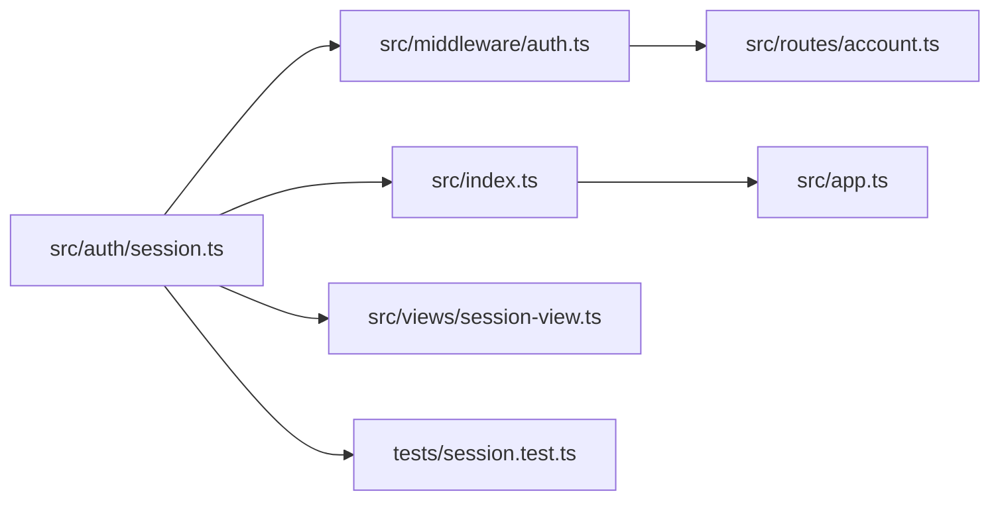
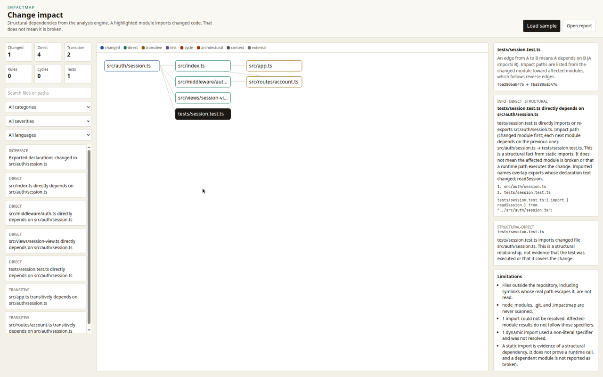

# ImpactMap

ImpactMap tells you which modules, packages, and tests are structurally connected to a code change before you merge it.

It reads source files, builds a dependency graph from real imports, compares Git revisions, and reports the evidence for every finding. It does not guess dependencies from filenames, and it does not need an LLM API key.

## Quick start

Requires Node.js 22 or newer and Git.

```bash
npm ci
npm run build
node packages/cli/dist/bin.js init
node packages/cli/dist/bin.js impact --base main
```

`npm link` from this repository exposes the `impactmap` command. The package is not published to npm yet.

Analysis is read-only. ImpactMap does not edit source files, create commits, merge pull requests, or deploy anything.

## What a change report answers

- Which modules import the changed file, directly or through other imports?
- Which packages sit on those paths?
- Which tests import the changed code, match a configured mapping, or only share a name?
- Did the change touch exported declaration text?
- Does the change cross a configured architecture rule or sit on a cycle?
- What was not analyzed?

A dependent module is not reported as broken. A static import is a structural fact, not proof of a runtime call.

## Example: a change to session handling

[`fixtures/ts-basic`](fixtures/ts-basic) is a small TypeScript app in this repository. The account route never imports the session module. It imports middleware, and the middleware imports the session module:

```ts
// fixtures/ts-basic/src/auth/session.ts
export function readSession(token: string): Session | null {
  if (!token) return null;
  return { userId: token };
}
```

```ts
// fixtures/ts-basic/src/middleware/auth.ts
import { readSession } from "../auth/session.js";

export function requireUser(token: string) {
  return readSession(token);
}
```

```ts
// fixtures/ts-basic/src/routes/account.ts
import { requireUser } from "../middleware/auth.js";

export function accountRoute(token: string) {
  return requireUser(token);
}
```

`tests/session.test.ts` imports `readSession` directly. `tests/math.test.ts` does not, so a session edit does not recommend it. `src/views/session-view.ts` imports only the `Session` type. `src/index.ts` re-exports `readSession`, and `src/app.ts` imports that barrel.

Impact direction, from the changed file toward modules that depend on it:



The arrows follow the report, which is the reverse of an import edge. `account.ts` imports `middleware/auth.ts`, and that file imports `session.ts`.

The captured run edited the working tree so `Session` gained `issuedAt` and `readSession` returned it. Command:

```bash
node packages/cli/dist/bin.js impact --base main
```

This excerpt is from that run. The commit prefix belongs to the capture. Every line below is copied from [`docs/examples/ts-basic-impact.txt`](docs/examples/ts-basic-impact.txt); the direct findings for `src/index.ts` and `src/views/session-view.ts`, and the transitive finding for `src/app.ts`, are in that file.

```text
ImpactMap
Base fba2806ab476 (main) → WORKTREE fba2806ab476
Scanned 12 files · skipped 4 · unresolved imports 1 · parse errors 0 · cycles 0

Changes (1)
  M src/auth/session.ts

Interface impact (1)
  INFO Exported declarations changed in src/auth/session.ts
    In src/auth/session.ts, exported declarations changed for Session, readSession. Declaration text includes the exported body when it is in the same statement, so this is not by itself a signature or runtime break. Callers are listed separately as direct or transitive impact.

Direct impact (4)
  INFO src/middleware/auth.ts directly depends on src/auth/session.ts
    path: src/auth/session.ts → src/middleware/auth.ts
    evidence: src/middleware/auth.ts:1 import { readSession } from "../auth/session.js";
  INFO tests/session.test.ts directly depends on src/auth/session.ts
    path: src/auth/session.ts → tests/session.test.ts
    evidence: tests/session.test.ts:1 import { readSession } from "../src/auth/session.js";

Transitive impact (2)
  INFO src/routes/account.ts transitively depends on src/auth/session.ts
    path: src/auth/session.ts → src/middleware/auth.ts → src/routes/account.ts
    evidence: src/middleware/auth.ts:1 import { readSession } from "../auth/session.js";
    evidence: src/routes/account.ts:1 import { requireUser } from "../middleware/auth.js";

Tests (1)
  tests/session.test.ts
    structural-direct: tests/session.test.ts imports changed file src/auth/session.ts. This is a structural relationship, not evidence that the test was executed or that it covers the change.
```

The header still says four direct and two transitive findings. The two direct findings omitted above are `src/index.ts` and `src/views/session-view.ts`. The other transitive finding is `src/app.ts`, reached through `src/index.ts`. The fixture has one unresolved import and one non-literal `import()`, and the report says those were not followed. `tests/math.test.ts` is absent.

The JSON from this run is [`apps/web/public/sample-report.json`](apps/web/public/sample-report.json). `npm run dev:web`, then **Load sample**, draws that graph:



To reproduce the capture, copy `fixtures/ts-basic` to a temporary Git repository, commit it, apply the `issuedAt` edit, build this repo, and run `impact --base main` from that copy. The SHA in the header will differ. The paths and evidence lines will not.

## Commands

| Command                         | What it does                                                                  |
| ------------------------------- | ----------------------------------------------------------------------------- |
| `impactmap analyze`             | Scan the working tree. Report dependencies, cycles, and configured rules.     |
| `impactmap impact --base main`  | Compare the working tree with the merge base of `main`.                       |
| `impactmap graph`               | Write the dependency graph as JSON. Edges point from importer to dependency.  |
| `impactmap cycles`              | List strongly connected components. `--strict` exits 1 when one exists.       |
| `impactmap tests --base main`   | List recommended tests. `--run` executes `test.command` if you configured it. |
| `impactmap check --base main`   | Same analysis as `impact`, with `ci.failOn` deciding exit code 1.             |
| `impactmap init`                | Write `impactmap.config.json` and print the supported keys.                   |
| `impactmap explain --base main` | Print a deterministic summary. `--ai` is optional and off by default.         |

`--format json` is stable enough for automation. Exit codes are documented in [docs/cli.md](docs/cli.md).

## Language support

| Language    | Status in 0.1.0      | What is extracted                                                                                                                  |
| ----------- | -------------------- | ---------------------------------------------------------------------------------------------------------------------------------- |
| TypeScript  | Supported            | Static imports and exports, `import type`, re-exports, literal `require` and `import()`, path aliases, workspace package `exports` |
| JavaScript  | Supported            | Same syntax parser as TypeScript                                                                                                   |
| Python      | Import-level         | `import` and `from ... import`, including parenthesized lists. Top-level `def` and `class` are recorded as exports.                |
| Other files | Reported, not parsed | Counted as unsupported. They do not become dependency edges.                                                                       |

See [docs/limitations.md](docs/limitations.md) before treating a report as complete.

## Repository layout

| Path               | Role                                                                      |
| ------------------ | ------------------------------------------------------------------------- |
| `packages/core`    | Discovery, resolution, Git diffs, impact, tests, cache, public API        |
| `packages/parsers` | Language parsers behind `LanguageParser`                                  |
| `packages/graph`   | Directed graph, reverse reachability, cycles                              |
| `packages/config`  | Schema and validation. Unknown keys are rejected.                         |
| `packages/cli`     | `impactmap` command                                                       |
| `packages/github`  | Pull request comment rendering and permission constants                   |
| `apps/web`         | Optional local graph explorer. It reads a JSON report. It has no backend. |
| `fixtures`         | Repositories with known dependency shapes, used by tests                  |

## Documentation

- [Architecture](docs/architecture.md)
- [Configuration](docs/configuration.md)
- [CLI](docs/cli.md)
- [GitHub Actions](docs/github-actions.md)
- [Security and privacy](docs/security.md)
- [Performance](docs/performance.md)
- [Limitations](docs/limitations.md)
- [Report format](docs/report-format.md)
- [Adding a parser](docs/parsers.md)
- [Contributing](CONTRIBUTING.md)
- [Roadmap](ROADMAP.md)

## Development

```bash
npm ci
npm test
npm run lint
npm run build:web
```

`npm test` typechecks the packages and runs Vitest, including CLI tests against `packages/cli/dist`. Rebuild with `npm run build` after changing the engine if you run the CLI directly.

## License

MIT. Copyright 2026 EC. See [LICENSE](LICENSE).
