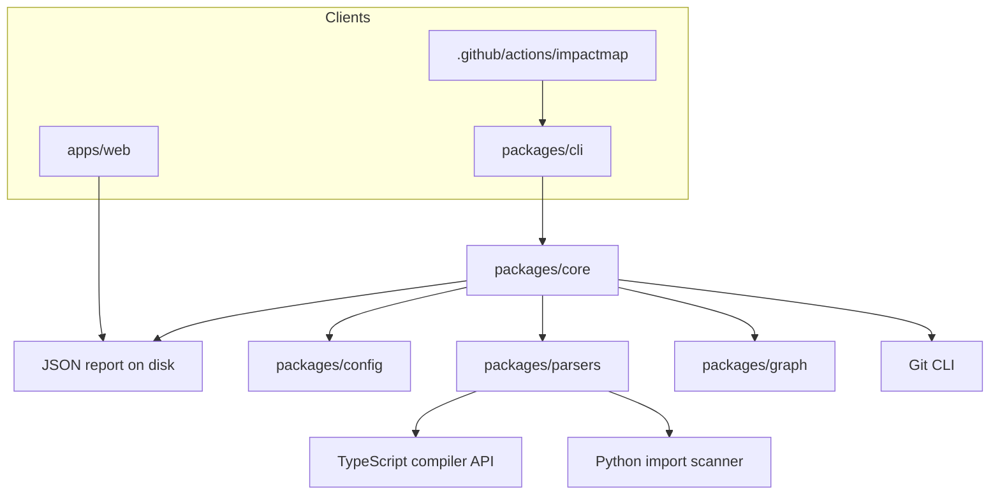

# Architecture

ImpactMap is a TypeScript monorepo. The analysis engine is a library (`@impactmap/core`). The CLI, GitHub Action, and web explorer are clients of that library or of the JSON report it writes.

## Pipeline

1. Find the Git root. Refuse to walk outside it.
2. Load and validate configuration. Missing config uses built-in defaults.
3. Discover files. Honor nested `.gitignore`, hard exclusions (`.git`, `node_modules`, `.impactmap`), and configured include and exclude globs. In revision mode, the file list is `git ls-tree` so ignored files are already absent.
4. Parse each supported file with the registered language parser.
5. Resolve specifiers to repository files, workspace packages, or `external:<name>` nodes.
6. Build a directed graph.
7. If `--base` is set, compute the Git diff and walk reverse dependencies from the changed files.
8. Evaluate architecture rules and select tests.
9. Emit one report. Text, JSON, and a file list are renderings of that report.

## Graph direction

An edge `from → to` means `from` depends on `to` (`from` imports `to`).

Impact paths are written in the opposite direction so a reviewer can read them from the change outward:

`src/auth/session.ts → src/middleware/auth.ts → src/routes/account.ts`

`session.ts` changed. `middleware/auth.ts` imports it. `account.ts` imports the middleware. That path is a chain of static imports. It is not a claim that `accountRoute` executes the new code.

Traversal limits live on the walk: maximum hop count, whether type-only edges count, whether dynamic edges count, and whether unresolved or external nodes are entered. Impact analysis includes unresolved edges so a deleted file still shows up as a dependent target, and it does not enter external package nodes.

Cycles are strongly connected components with more than one node, plus self-imports. The report lists one traced cycle per component, not every simple cycle in that component.

## Revisions

`--base` is resolved to a commit, then to the merge base with the head snapshot.

- Omit `--head` to analyze the working tree: the merge-base diff plus staged, unstaged, and untracked files that Git does not ignore.
- Pass `--head` to analyze that commit. If it is `HEAD` and the worktree is clean, the commit snapshot is used. A dirty worktree is still the thing under review when `--head` is omitted.
- Refs are resolved to 40-character SHAs before `git diff`. Git is invoked with `shell: false` and `--end-of-options`.

Historical analysis reads blobs with `git cat-file --batch`. It does not install that revision's `node_modules`. Bare specifiers that only resolve through a dependency installed at that revision can show up as external or unresolved.

## Cache

The cache directory is `.impactmap/cache` unless configured. It must be a relative path inside the repository.

A per-file parse entry is reused when the file bytes and `PARSER_VERSION` match. Resolved edges are reused only when the parser version, config hash, resolver inputs (tsconfig, jsconfig, package manifests), the file set, and the deleted-file set all match. Changing one file re-resolves that file. Adding or deleting a path, or editing `tsconfig.json` or `package.json`, invalidates edges. A corrupt cache file is ignored. Revision snapshots do not read the worktree cache.

Cache statistics are part of the report, so two JSON reports can differ in `cache` while describing the same findings. Tests that compare findings strip `cache`.

## Web explorer

`apps/web` does not import `@impactmap/core` and does not run Node or the TypeScript compiler in the browser. It draws `report.graph` from a version 1 JSON file. Neighborhoods larger than 60 nodes ask for a filter instead of rendering every node.
